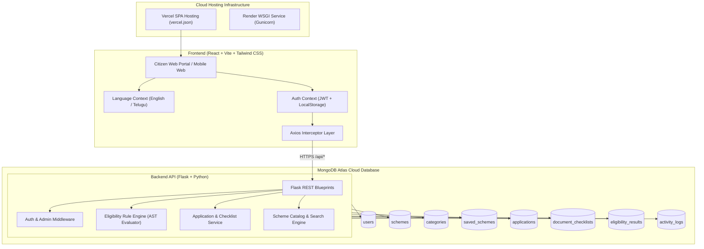
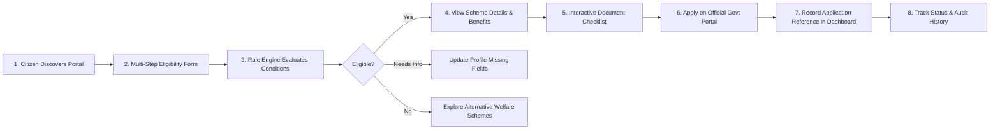
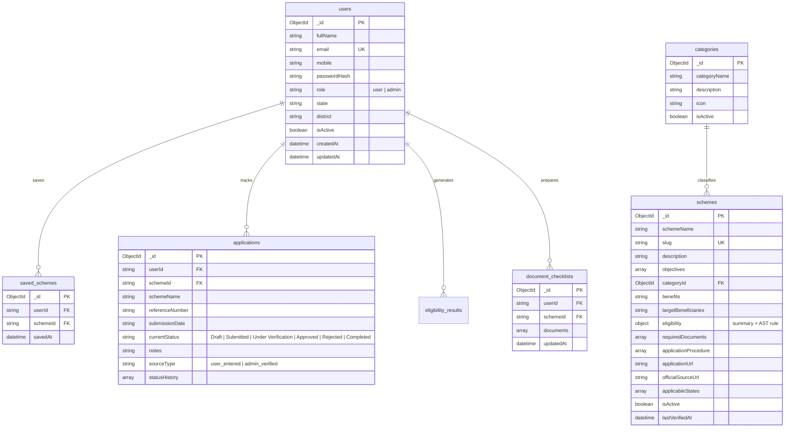

# GovScheme – Government Scheme Awareness and Assistance Portal

[](https://react.dev/)
[](https://flask.palletsprojects.com/)
[](https://www.mongodb.com/atlas)
[](https://tailwindcss.com/)
[](#multilingual-support)

A modern, production-ready centralized web portal designed to help Indian citizens discover government welfare schemes, evaluate rule-based eligibility, prepare required documents, and access benefits.

---

## 1. Problem Statement & Objectives

Millions of eligible Indian citizens miss out on life-changing welfare programs because scheme details are scattered across disparate ministry websites with ambiguous eligibility conditions and document requirements.

**GovScheme solves this by delivering:**
1. **Centralized Discovery**: Browse verified central and state welfare initiatives across Agriculture, Healthcare, Housing, Education, Pensions, and Skill Development.
2. **Deterministic Rule Engine**: An automated AST evaluation engine in Python evaluating multiple conditions (`==, !=, >, <, >=, <=, IN, NOT_IN, EXISTS`, nested `AND/OR`) that transparently explains matched, missing, or unmet conditions.
3. **Document Preparation Assistance**: Interactive checklists allowing citizens to mark certificates as *Prepared* or *Not Prepared* before applying.
4. **Application Milestone Tracking**: Citizen application record management tracking reference numbers, submission dates, and admin verification histories.
5. **Full Vernacular Support**: Complete bilingual interface in English and Telugu (`తెలుగు`).

---

## 2. Technology Stack

- **Frontend**:
  - React 18, Vite
  - Tailwind CSS (Indian Tricolour-inspired theme: Navy `#123B69`, Dark Blue `#0B2545`, Saffron `#FF9933`, Green `#138808`)
  - React Router DOM v6
  - Axios HTTP Client with JWT interceptors
  - Lucide React icons
  - Framer Motion
- **Backend**:
  - Python 3.13, Flask 3
  - Flask-CORS (Approved frontend origins)
  - PyMongo & dnspython (MongoDB Atlas Cloud connection)
  - PyJWT & Werkzeug security (salted scrypt password hashing)
  - Flask-Limiter (API rate limiting)
  - Gunicorn (Production WSGI server)
  - In-memory `mongomock` fallback for local zero-config testing
- **Database**:
  - MongoDB Atlas Cloud Database (`govscheme` database)
- **Deployment**:
  - Vercel: Single Page Application frontend
  - Render: Python Flask Gunicorn backend

---

## 3. System Architecture



---

## 4. Citizen User Journey Workflow



---

## 5. Database Schema & Collections



---

## 6. Project Directory Structure

```
govscheme/
├── backend/
│   ├── app/
│   │   ├── __init__.py          # Flask app factory, CORS, Rate limiter, routes
│   │   ├── config/
│   │   │   ├── database.py      # MongoDB Atlas connection & auto-seed fallback
│   │   │   └── settings.py      # App configurations & environment parsing
│   │   ├── middleware/
│   │   │   ├── auth_middleware.py   # JWT extractor and user context
│   │   │   └── admin_middleware.py  # Administrator role enforcement
│   │   ├── routes/
│   │   │   ├── auth_routes.py        # /api/auth/register, login, me, reset
│   │   │   ├── user_routes.py        # /api/users/profile, change-password, activity
│   │   │   ├── scheme_routes.py      # /api/schemes, stats, search, saved-schemes
│   │   │   ├── category_routes.py    # /api/categories
│   │   │   ├── eligibility_routes.py # /api/eligibility/check, history
│   │   │   ├── application_routes.py # /api/applications, /api/documents
│   │   │   └── admin_routes.py       # /api/admin/dashboard, users, schemes, status
│   │   ├── services/
│   │   │   ├── auth_service.py       # User credentials, hashing, JWT logic
│   │   │   ├── eligibility_engine.py # AST Rule evaluation engine
│   │   │   ├── scheme_service.py     # Scheme filters, search, pagination, stats
│   │   │   └── application_service.py# Citizen applications & document checklists
│   │   └── utils/
│   │       ├── responses.py     # Standardized JSON response serializer
│   │       └── security.py      # Password hashers & JWT encoder/decoder
│   ├── seed/
│   │   └── seed_data.py         # 10 verified Indian schemes seed data
│   ├── tests/
│   │   └── test_api.py          # Pytest suite covering all core workflows
│   ├── .env.example
│   ├── Procfile                 # Render Gunicorn start command
│   ├── requirements.txt         # Python dependencies
│   └── run.py                   # Development & production runner
├── frontend/
│   ├── public/
│   │   └── logo.svg             # GovScheme emblem logo
│   ├── src/
│   │   ├── admin/               # Admin Management Pages
│   │   │   ├── AdminDashboard.jsx
│   │   │   ├── ManageSchemes.jsx
│   │   │   ├── ManageCategories.jsx
│   │   │   ├── ManageUsers.jsx
│   │   │   ├── ManageApplications.jsx
│   │   │   └── ManageEligibility.jsx
│   │   ├── components/
│   │   │   ├── cards/SchemeCard.jsx
│   │   │   ├── footer/Footer.jsx
│   │   │   └── navbar/Navbar.jsx
│   │   ├── context/
│   │   │   ├── AuthContext.jsx       # User session state & JWT management
│   │   │   └── LanguageContext.jsx   # English & Telugu localization
│   │   ├── layouts/
│   │   │   ├── MainLayout.jsx
│   │   │   ├── DashboardLayout.jsx
│   │   │   └── AdminLayout.jsx
│   │   ├── pages/
│   │   │   ├── Home.jsx              # Landing page with live statistics
│   │   │   ├── ExploreSchemes.jsx    # Search, multi-filter, pagination
│   │   │   ├── SchemeDetails.jsx     # Overview, eligibility, documents, procedure
│   │   │   ├── Categories.jsx        # Welfare sectors
│   │   │   ├── EligibilityChecker.jsx# 5-step wizard with rule engine results
│   │   │   ├── ApplicationAssistance.jsx # Document checklist tracker
│   │   │   ├── UserDashboard.jsx     # Citizen metrics, applications, bookmarks
│   │   │   ├── SavedSchemes.jsx      # Bookmarks manager
│   │   │   ├── MyApplications.jsx    # Application reference tracker & history
│   │   │   ├── Profile.jsx           # Citizen profile & password change
│   │   │   ├── About.jsx             # Mission & objectives
│   │   │   ├── Contact.jsx           # Citizen helpdesk & query form
│   │   │   └── NotFound.jsx          # 404 page
│   │   ├── services/                 # Axios API services
│   │   ├── translations/
│   │   │   ├── en.json               # English translations
│   │   │   └── te.json               # Telugu translations (తెలుగు)
│   │   ├── App.jsx                   # Route configurations
│   │   ├── index.css                 # Tailwind directives
│   │   └── main.jsx
│   ├── .env.example
│   ├── index.html
│   ├── package.json
│   ├── tailwind.config.js
│   ├── vercel.json                  # SPA rewrite rules
│   └── vite.config.js
├── .gitignore
└── README.md
```

---

## 7. Verified Indian Government Schemes Seeded

The database includes realistic, verified official data for 20 flagship schemes:
1. **PM-KISAN** (Pradhan Mantri Kisan Samman Nidhi) — Agriculture (₹6,000/year DBT)
2. **Ayushman Bharat PM-JAY** — Healthcare (₹5 Lakhs/year cashless insurance)
3. **Pradhan Mantri Awas Yojana (PMAY)** — Housing (Pucca housing financial grant)
4. **National Scholarship Portal (NSP)** — Education (Tuition reimbursement & maintenance allowance)
5. **Atal Pension Yojana (APY)** — Pension & Social Security (Guaranteed monthly pension ₹1,000–₹5,000)
6. **PM Vishwakarma Scheme** — Traditional Artisans & Skill Development (₹15,000 toolkit + ₹3L credit)
7. **MGNREGA** — Rural Employment Guarantee (100 days statutory wage employment)
8. **Sukanya Samriddhi Yojana (SSY)** — Women & Girl Child Welfare (8.2% sovereign tax-free interest)
9. **PM Mudra Yojana (PMMY)** — Financial Assistance & Small Business (Collateral-free loans up to ₹10L)
10. **Indira Gandhi National Old Age Pension (IGNOAPS)** — Senior Citizens BPL Pension
11. **Pradhan Mantri Ujjwala Yojana (PMUY 2.0)** — Women Welfare (Free LPG connection + first refill & stove)
12. **PM Surya Ghar: Muft Bijli Yojana** — Housing & Renewable Energy (Up to ₹78,000 solar subsidy + 300 free units/mo)
13. **Pradhan Mantri Matru Vandana Yojana (PMMVY)** — Women & Child Health (₹5,000 - ₹6,000 direct maternity benefit)
14. **Pradhan Mantri Fasal Bima Yojana (PMFBY)** — Agriculture (Comprehensive crop insurance at 1.5%–2% premium)
15. **National Apprenticeship Promotion Scheme (NAPS)** — Skill Development & Youth (Monthly stipend assistance up to ₹1,500/mo)
16. **Unique Disability ID (UDID) & Swavlamban Welfare** — Healthcare / Divyangjan (Universal smart card & concessions)
17. **PM SVANidhi** — Financial Assistance (Collateral-free micro-credit loans up to ₹50,000 for street vendors)
18. **Pradhan Mantri Jeevan Jyoti Bima Yojana (PMJJBY)** — Social Security (₹2,00,000 life insurance for ₹436/year)
19. **Kisan Credit Card (KCC) Scheme** — Agriculture (Subsidized crop & dairy revolving credit up to ₹3,00,000 at 4%)
20. **Merit-Cum-Means Scholarship for Professional Courses** — Education (Full tuition reimbursement + living allowance)

### Default Credentials Seeded:
- **Portal Administrator**: `admin@govscheme.nic.in` / `Admin@12345`
- **Demo Citizen**: `citizen@govscheme.in` / `Citizen@12345`

---

## 8. Installation & Local Execution

### Prerequisites
- Node.js v18+ and npm
- Python 3.10+
- Git

### 1. Backend Setup
```bash
cd govscheme/backend

# Create and activate Python virtual environment
python -m venv venv
# On Windows:
.\venv\Scripts\activate
# On Linux/macOS:
# source venv/bin/activate

# Install requirements
pip install -r requirements.txt

# Run seed script (creates demo users, categories, verified schemes)
python seed/seed_data.py

# Start Flask development server
python run.py
# Server runs on http://localhost:5000
```

### 2. Frontend Setup
```bash
cd govscheme/frontend

# Install dependencies
npm install

# Start Vite dev server
npm run dev
# Portal accessible on http://localhost:5173
```

---

## 9. Environment Variables

### Backend (`govscheme/backend/.env`)
```ini
FLASK_ENV=development
PORT=5000
DEBUG=True

SECRET_KEY=govscheme-super-secret-key-change-in-prod-2026
JWT_SECRET_KEY=govscheme-jwt-secret-key-32bytes-secure

# MongoDB Atlas URI (leave blank for local in-memory fallback during offline dev)
MONGODB_URI=mongodb+srv://<username>:<password>@cluster0.mongodb.net/govscheme?retryWrites=true&w=majority
DB_NAME=govscheme

FRONTEND_URL=http://localhost:5173
```

### Frontend (`govscheme/frontend/.env`)
```ini
VITE_API_URL=http://localhost:5000/api
```

---

## 10. REST API Reference

| Endpoint | Method | Auth | Description |
|---|---|---|---|
| `/api/health` | GET | Public | Health check & DB connection status |
| `/api/auth/register` | POST | Public | Citizen registration |
| `/api/auth/login` | POST | Public | Citizen / Admin login (returns JWT) |
| `/api/auth/me` | GET | Token | Current session profile |
| `/api/schemes` | GET | Optional | List schemes with search, category, state, pagination |
| `/api/schemes/:id` | GET | Public | Full scheme details |
| `/api/schemes/stats` | GET | Public | Live database portal counts |
| `/api/categories` | GET | Public | All active welfare categories |
| `/api/eligibility/check` | POST | Optional | AST rule evaluation for user demographic |
| `/api/saved-schemes` | GET/POST | Token | Manage bookmarked schemes |
| `/api/applications` | GET/POST | Token | Citizen application record tracker |
| `/api/documents/:schemeId` | GET/PUT | Token | Interactive document checklist |
| `/api/admin/dashboard` | GET | Admin | Administrator metrics and audit counters |
| `/api/admin/schemes` | GET/POST | Admin | CRUD operations for welfare schemes |
| `/api/admin/users` | GET | Admin | Citizen account management & activation |
| `/api/admin/applications/:id/status` | PUT | Admin | Update verified milestone status with notes |

---

## 11. Production Deployment Guide

### 1. MongoDB Atlas Setup
1. Log in to [MongoDB Atlas](https://www.mongodb.com/atlas).
2. Create a free shared cluster (M0) in `ap-south-1 (Mumbai)`.
3. Create a Database User with read/write access.
4. In **Network Access**, add `0.0.0.0/0` (Allow access from anywhere).
5. In **Database**, name it `govscheme`.
6. Copy the connection string (`mongodb+srv://...`).

### 2. Render Backend Deployment
1. Log in to [Render](https://render.com) and create a **Web Service**.
2. Connect your GitHub repository.
3. Root Directory: `govscheme/backend`.
4. Runtime: `Python 3`.
5. Build Command: `pip install -r requirements.txt`.
6. Start Command: `gunicorn --bind 0.0.0.0:$PORT "run:app"`.
7. Add Environment Variables:
   - `MONGODB_URI` = your Atlas connection string
   - `JWT_SECRET_KEY` = a secure 64-char random hex string
   - `SECRET_KEY` = a secure 64-char random hex string
   - `FLASK_ENV` = `production`
   - `FRONTEND_URL` = your Vercel deployment URL

### 3. Vercel Frontend Deployment
1. Log in to [Vercel](https://vercel.com) and create a **New Project**.
2. Select your repository and set Root Directory to `govscheme/frontend`.
3. Framework Preset: `Vite`.
4. Build Command: `npm run build`.
5. Output Directory: `dist`.
6. Environment Variable:
   - `VITE_API_URL` = `https://<your-render-backend-url>/api`
7. Deploy! `vercel.json` ensures full SPA routing support for React Router.

---

## 12. Automated Testing

To run the backend test suite:
```bash
cd govscheme/backend
$env:PYTHONPATH="."
pytest tests
```
Verified test suite covers:
- Health check & server status
- Citizen & Administrator authentication
- Duplicate registration & password hashing
- Scheme catalog pagination & real stats
- Dynamic Rule Engine evaluation on Farmer & Student profiles
- Role-based route protection on administrative endpoints (403 Forbidden enforcement)

To verify frontend production bundle:
```bash
cd govscheme/frontend
npm run build
```

---

## 13. Future Enhancements

- **AI-Powered Scheme Chatbot**: Direct conversational assistance for citizens.
- **Voice-Based Search**: Voice input recognition in Telugu and Hindi for rural and illiterate citizens.
- **WhatsApp / SMS Updates**: Proactive notifications when application milestones update.
- **DigiLocker Integration**: Automated retrieval of verified Aadhaar, caste, and income certificates.

---

## 14. License

Distributed under the Apache 2.0 License. Developed for Indian Public Welfare Awareness.
